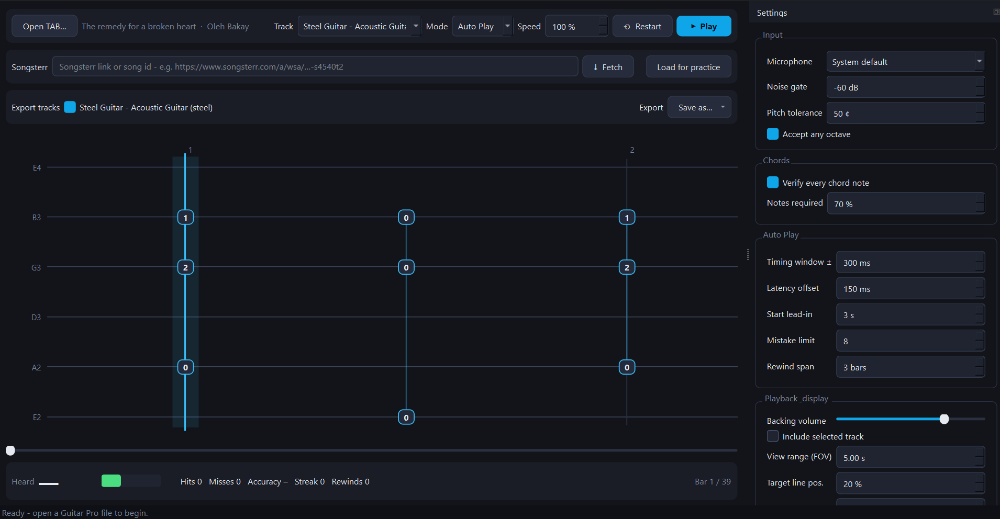

<div dir="rtl" align="right">

<div align="center">

# 🎸 FretFlow

**تب‌های گیتار را با نواختن یاد بگیر؛ نت‌ها به سمت خط هدف می‌آیند و گیتار خودت کنترلر است.**

تشخیص لحظه‌ای نت و آکورد · حالت‌های Auto Play و Follow Me · وارد کردن فایل Guitar Pro · کاملاً آفلاین

[English](README.md) | فارسی



</div>

## این برنامه چیست؟

FretFlow یک ابزار سبک دسکتاپ برای تمرین گیتار است. یک تب Guitar Pro باز می‌کنی، گیتار را (با کابل یا میکروفون) وصل می‌کنی و نت‌هایی را که از **راست به چپ** به خط هدف می‌رسند می‌نوازی؛ شبیه بازی‌های ریتمی ولی با ساز واقعی. برنامه به صدای تو گوش می‌دهد، درست و غلط را نشان می‌دهد و کمک می‌کند بخش‌های اشتباه را دوباره تمرین کنی.

## قابلیت‌ها

- 🎼 **وارد کردن تب:** فایل‌های **.gp** (گیتار پرو ۷ و ۸) و **.gp5 / .gp4 / .gp3**؛ پشتیبانی از چند تراک، لیگاتو، آکورد، نت‌های خفه‌شده، تغییر تمپو، کاپو و کوک ذخیره‌شده در فایل.
- 🎯 **تشخیص لحظه‌ای:** ورودی میکروفون یا کارت صدا؛ تشخیص سریع نت تکی (YIN) و تشخیص زدن دوباره‌ی یک نت.
- 🎶 **بررسی آکورد:** تحلیل طیف برای **تک‌تک نت‌های** آکورد (بر اساس نت‌های مورد انتظار تب)، با نمایش سبز/قرمز برای هر نت.
- ▶️ **Auto Play:** تب همراه موسیقی پس‌زمینه‌ی ساخته‌شده از بقیه‌ی تراک‌ها حرکت می‌کند. نت درست سبز و نت خطا قرمز می‌شود. اگر اشتباهات از حد مجاز بیشتر شود، برنامه خودکار به بخش اخیر برمی‌گردد تا دوباره امتحان کنی.
- ⏸️ **Follow Me:** تب منتظر می‌ماند؛ نت فعلی تا وقتی درست نزنی هایلایت می‌ماند.
- 🐢 **سرعت تمرین:** از ۲۵٪ تا ۱۵۰٪ (صدا بم و زیری‌اش را حفظ می‌کند).
- ⏪ **شروع زودتر:** Auto Play چند ثانیه زودتر شروع می‌شود تا آماده شوی (قابل تنظیم).
- 👁️ **دید قابل تنظیم:** تعیین کن چند ثانیه از تب جلوتر دیده شود (FOV) و خط هدف کجا باشد.
- 🌐 **ورود از Songsterr:** لینک یا شناسه‌ی آهنگ را در نوار Songsterr بچسبان، Fetch و بعد Load for practice بزن؛ تب دانلود و خودکار به Guitar Pro تبدیل می‌شود (بندینگ، اسلاید، تریپلت و تغییر تمپو حفظ می‌شود).
- 💾 **خروجی گرفتن:** هر آهنگ بارگذاری‌شده (فایل محلی یا Songsterr) را با تراک‌های تیک‌خورده به **.gp5**، **.gp** (GP7/8)، **MIDI** یا **JSON** ذخیره کن.
- 🧷 **کاپو:** شماره‌ی فرت‌ها نسبت به کاپو نمایش داده می‌شود، بدون اینکه صدای مورد انتظار عوض شود.
- 🎚️ **تنظیمات دقیق:** نویز گیت، تلورانس پیچ (سنت)، پنجره‌ی زمانی، جبران تأخیر، پذیرش هر اکتاو، حد اشتباه، تعداد میزهای بازگشت، سخت‌گیری آکورد.
- 🌑 **رابط تیره و مدرن:** پنل تنظیمات جداشدنی، نوار پیشرفت، نمایش نت شنیده‌شده، متر سطح صدا، دقت و رکورد پشت‌سرهم.
- 📴 **آفلاین:** بدون حساب کاربری و بدون ارسال هیچ داده‌ای.

## شروع سریع

### دانلود (ویندوز)
آخرین نسخه‌ی `FretFlow-windows.zip` را از صفحه‌ی [Releases](../../releases) دانلود کن، از حالت فشرده خارج کن و `FretFlow.exe` را اجرا کن.

### اجرا از سورس
```bash
git clone https://github.com/miladdehaghi/FretFlow.git
cd FretFlow
pip install -r requirements.txt
python main.py
```

### ساخت فایل exe
```bash
build_exe.bat        # خروجی: dist\FretFlow\FretFlow.exe
```

## طرز استفاده

1. روی **Open TAB…** بزن، فایل را انتخاب کن و **Track** مورد نظر را برگزین.
2. **Mode** را انتخاب کن و با **Space** پخش/توقف یا با **Home** شروع دوباره بزن.
3. وقتی نت‌ها به خط هدف رسیدند بنواز.
   - **Auto Play:** بر اساس نت و زمان‌بندی داوری می‌شود.
   - **Follow Me:** فقط با نواختن درست نت یا آکورد جلو می‌رود.
4. از پنل **Settings** تشخیص را با تجهیزات خودت تنظیم کن.

### ورود از Songsterr و خروجی گرفتن
1. لینک Songsterr (مثل `https://www.songsterr.com/a/wsa/…-s4540`) یا فقط شناسه‌ی عددی را در نوار **Songsterr** بچسبان.
2. **Fetch** اطلاعات آهنگ و تراک‌ها را نشان می‌دهد؛ **Load for practice** آن را به `.gp5` تبدیل می‌کند (در پوشه‌ی temp ذخیره می‌شود) و برای تمرین باز می‌کند.
3. در ردیف **Export tracks** تراک‌ها را تیک بزن و به `.gp5`، `.gp`، `.mid` یا `.json` خروجی بگیر.

> ⚠️ پشتیبانی Songsterr **غیررسمی** است و از آدرس‌های مستندنشده استفاده می‌کند. FretFlow هیچ وابستگی‌ای به Songsterr ندارد. تب‌ها رونویسی‌های دارای حق کپی‌رایت هستند؛ فقط برای تمرین شخصی استفاده کن و شرایط استفاده‌ی Songsterr را رعایت کن.

### آکورد
حدود ۲۳۰ میلی‌ثانیه بعد از زدن آکورد (وقتی نویز حمله‌ی صدا فروکش کرد) طیف بررسی می‌شود. برنامه برای هر نتِ مورد انتظار دنبال قله‌ی واقعی در فرکانس پایه و هارمونیک‌ها می‌گردد و هر نت را **سبز (پیدا شد)** یا **قرمز (نبود)** نشان می‌دهد. گزینه‌ی *Notes required* سخت‌گیری را تعیین می‌کند (۱۰۰٪ = همه‌ی نت‌ها). با خاموش کردن *Verify every chord note* زدن فقط یک نت از آکورد کافی است.

### کاپو
مقدار *Capo fret* را در Settings تنظیم کن. اگر فایل گیتار پرو خودش کاپو دارد، این مقدار را صفر بگذار.

## نکات برای دقت بهتر

- **کارت صدا یا ورودی مستقیم** نتیجه‌ی بسیار بهتری از میکروفون لپ‌تاپ می‌دهد.
- گیتار را کوک کن (تلورانس پیش‌فرض ±۵۰ سنت است).
- نت درست دیر یا زود حساب می‌شود؟ **Latency offset** را تنظیم کن. نویز محیط نت اشتباه می‌سازد؟ **Noise gate** را بالا ببر.
- اکتاو سیم‌های بم اشتباه تشخیص داده می‌شود؟ **Accept any octave** را روشن کن.

## عیب‌یابی

| مشکل | راه‌حل |
|---|---|
| کنار Heard فقط `—` است | ورودی درست را انتخاب کن، متر صدا را ببین، Noise gate را کم کن. |
| اکتاو نت اشتباه است | Accept any octave را روشن کن و میکروفون را نزدیک‌تر ببر. |
| نت درست دیر/Miss حساب می‌شود | Latency offset یا Timing window را زیاد کن. |
| آکورد درست رد می‌شود | Notes required را کم کن، حدود ۰٫۳ ثانیه برای نتیجه صبر کن. |
| دریافت از Songsterr خطا می‌دهد | لینک و اینترنت را چک کن؛ ممکن است بعضی تراک‌ها در دسترس نباشند. آدرس‌های Songsterr غیررسمی‌اند و ممکن است تغییر کنند. |
| فایل `.gpx` باز نمی‌شود | گیتار پرو ۶ پشتیبانی نمی‌شود؛ با `.gp` یا `.gp5` دوباره ذخیره کن. |

## محدودیت‌ها

- ورود از Songsterr به آدرس‌های غیررسمی وابسته است و ممکن است از کار بیفتد؛ فرمت قدیمی **GPX**، باز کردن تکرارها (Repeat) و تغییر تمپو در وسط میزان پشتیبانی نمی‌شود.
- بررسی آکورد بر پایه‌ی نت‌های مورد انتظار است، نه رونویسی کامل؛ نت اضافه یا اشتباه بیرون از آکورد جریمه نمی‌شود.
- موسیقی پس‌زمینه یک سینتی‌سایزر ساده است.
- تکنیک‌هایی مثل بندینگ و اسلاید هنوز نمایش داده یا داوری نمی‌شوند.

## منابع و قدردانی

- تبدیل Songsterr به Guitar Pro بر اساس روش پروژه‌ی [SongsterrToGuitarPro](https://github.com/djrobson5/SongsterrToGuitarPro) از djrobson5 است.
- خواندن فایل‌های GP3–5: [PyGuitarPro](https://github.com/Perlence/PyGuitarPro) و رابط کاربری: [PySide6](https://doc.qt.io/qtforpython/).

## مشارکت

Issue و Pull Request خوشحالمان می‌کند. بخش منطق (`engine.py`، `chords.py`، `pitch.py`) وابستگی به Qt ندارد و تست‌کردنش راحت است.

## مجوز

[MIT](LICENSE)

</div>
