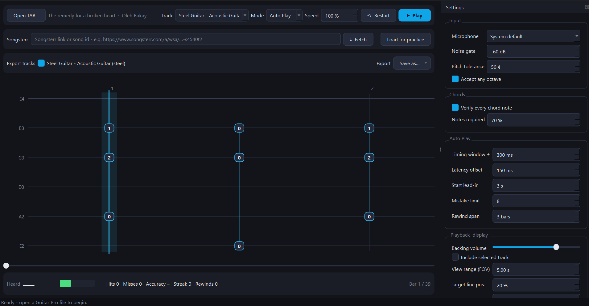

<div align="center">

# 🎸 FretFlow

**Learn guitar tabs by playing them — notes scroll toward the target line, your guitar is the controller.**

Real-time note & chord detection · Auto Play and Follow Me modes · Guitar Pro import · 100 % offline

English | [فارسی](README.fa.md)

   



</div>

## What is it?

FretFlow is a lightweight desktop practice tool for guitarists. Open a Guitar Pro tab, plug in your guitar (or use a microphone), and play the notes as they travel **right → left** to a fixed target line — like a rhythm game, but with your real instrument. It listens to you, tells you what you got right, and helps you repeat the parts you got wrong.

## Features

| | |
|---|---|
| 🎼 **Tab import** | Guitar Pro **.gp** (GP7/8), **.gp5, .gp4, .gp3**. Multi-track files, ties, chords, muted notes, tempo changes, capo and tuning from the file. |
| 🎯 **Real-time detection** | Microphone / audio-interface input. Fast YIN pitch tracking for single notes, re-pluck detection for repeated notes. |
| 🎶 **Chord verification** | Score-informed spectrum check of **every note** of a chord, with per-note green/red feedback and an octave-aliasing guard. |
| ▶️ **Auto Play** | The tab scrolls with a synthesized backing of the other tracks. Hits turn green, misses red. Too many mistakes → automatically rewinds to the recent section so you can retry. |
| ⏸️ **Follow Me** | The tab waits for you. The current note stays highlighted until you play it correctly. |
| 🐢 **Practice speed** | 25 %–150 % in Auto Play; backing music keeps its pitch. |
| ⏪ **Lead-in** | Auto Play starts a few seconds early so you can get ready (configurable). |
| 👁️ **Adjustable view** | Set how many seconds of tab you see ahead (FOV) and where the target line sits. |
| 🌐 **Songsterr import** | Paste a Songsterr link or song id → *Fetch* → *Load for practice*. The tab is downloaded and converted to Guitar Pro on the fly (bends, slides, tuplets, tempo changes kept). |
| 💾 **Export** | Save any loaded song (local file or Songsterr) as **.gp5**, **.gp** (GP7/8), **MIDI** or **JSON**, with the tracks you tick. |
| 🧷 **Capo** | Show fret numbers relative to a capo without changing the expected pitch. |
| 🎚️ **Tunable judging** | Noise gate, pitch tolerance (cents), timing window, latency offset, "accept any octave", mistake limit, rewind span, chord strictness. |
| 🌑 **Modern dark UI** | Dockable settings panel, progress/seek bar, live "heard note" display and level meter, accuracy / streak statistics. |
| 📴 **Offline** | No accounts, no cloud, nothing leaves your computer. |

## Quick start

### Download (Windows)
Grab the latest `FretFlow-windows.zip` from the [Releases](../../releases) page, unzip, run `FretFlow.exe`.

### Run from source
```bash
git clone https://github.com/miladdehaghi/FretFlow.git
cd FretFlow
python -m venv .venv && .venv\Scripts\activate      # optional
pip install -r requirements.txt
python main.py
```

### Build the .exe yourself
```bash
build_exe.bat        # → dist\FretFlow\FretFlow.exe
```

## How to use

1. **Open TAB…** and choose a `.gp / .gp5 / .gp4 / .gp3` file, then pick your **Track**.
2. Choose a **Mode**, then press **Space** (play / pause) or **Home** (restart).
3. Play the notes when they reach the target line.
   - **Auto Play** — judged by pitch and timing. Hit = green, miss = red.
   - **Follow Me** — advances only when the correct note / chord is detected.
4. Open the **Settings** dock to tune detection to your setup.

| Shortcut | Action |
|---|---|
| `Space` | Play / pause |
| `Home` | Restart |

### Songsterr import & export
1. Paste a Songsterr URL (e.g. `https://www.songsterr.com/a/wsa/…-s4540`) or just the numeric id into the **Songsterr** bar.
2. **Fetch** shows the song and its tracks; **Load for practice** converts it to a `.gp5` (cached in your temp folder) and opens it.
3. Tick the tracks you want in the **Export tracks** row and export to `.gp5`, `.gp`, `.mid` or `.json`. Songs from Songsterr keep full fidelity in `.gp5`; other songs are re-saved or rebuilt from the internal model.

> ⚠️ Songsterr support is **unofficial** and uses undocumented endpoints. FretFlow is not affiliated with Songsterr. Tabs are copyrighted transcriptions — use this feature for personal practice only and respect Songsterr's terms of service.

### Chords
A strum is analysed ~230 ms after the attack (once transient noise has settled). The app looks for a real spectral peak at each *expected* note and its harmonics. After an attempt every note of the chord is outlined **green (found)** or **red (missing)**. *Notes required* (Settings → Chords) sets the strictness: 100 % = all notes, 70 % = may miss about one of four or five. Disable *Verify every chord note* to accept any single note of the chord.

### Capo
Set *Capo fret* in Settings. Fret numbers on screen are shown minus the capo (notes below the capo show "–"), while the detected pitch must still match the original tab. If a Guitar Pro file already stores a capo, leave this at 0.

## Tips for best accuracy

- An **audio interface or direct input** gives much cleaner results than a laptop microphone.
- Tune your guitar; detection tolerance is ±50 cents by default.
- Correct notes judged late/early → adjust **Latency offset**. Room noise triggers notes → raise **Noise gate**.
- Wrong octave on low strings → enable **Accept any octave**.

## Troubleshooting

| Problem | Fix |
|---|---|
| "Heard" shows `—` | Select the right input device; check the level meter; lower the noise gate. |
| Notes show the wrong octave | Enable *Accept any octave*; move the mic closer. |
| Correct notes marked late/missed | Increase *Latency offset* or *Timing window*. |
| Chords fail though played correctly | Lower *Notes required*; wait ~0.3 s for feedback; use a cleaner tone. |
| Songsterr fetch fails | Check the link / internet connection; some tracks may be unavailable. Songsterr's endpoints are unofficial and can change. |
| `.gpx` file won't open | Legacy Guitar Pro 6 isn't supported — re-save as `.gp` or `.gp5`. |

## Project structure

```
main.py                  entry point
app/models.py            Song / Track / Event / Note dataclasses
app/gp_loader.py         format registry + GP3-5 import
app/gpif_loader.py       GP7/GP8 (.gp) import – ZIP + XML, stdlib only
app/songsterr.py         Songsterr fetch layer (urllib, stdlib only)
app/songsterr_convert.py Songsterr JSON → Guitar Pro 5 (PyGuitarPro)
app/exporter.py          export to .gp5 / .gp / .mid / .json
app/pitch.py             YIN pitch detector (numpy)
app/chords.py            score-informed chord verification
app/audio_in.py          microphone capture, note / strum tracking (worker thread)
app/audio_out.py         backing synth + sample-accurate clock
app/engine.py            Auto Play / Follow Me logic (no Qt, testable)
app/settings.py          persisted settings
app/ui/                  dark theme, TabView renderer, main window
```

## Known limitations

- Songsterr import depends on unofficial endpoints that may change; legacy **GPX** (Guitar Pro 6) is not supported; repeats are not unrolled; tempo changes inside a bar are ignored.
- Chord checking is score-informed, not full transcription: extra or wrong notes outside the expected chord aren't penalised, and an octave double of a note you did play can slip through.
- Backing track is a simple built-in synth (no soundfont).
- Bends, slides and other techniques are not displayed/judged yet.

## Roadmap ideas

Loop a section · soundfont/MIDI backing · technique display (bends, slides, hammer-ons) · metronome & count-in click · GPX support · macOS/Linux builds · per-song statistics.

## Contributing

Issues and pull requests are welcome. The playing logic (`engine.py`, `chords.py`, `pitch.py`) has no Qt dependency, which makes it easy to test. Please open an issue first for big changes.

## Credits

- Songsterr → Guitar Pro conversion is based on the approach of [SongsterrToGuitarPro](https://github.com/djrobson5/SongsterrToGuitarPro) by djrobson5.
- Guitar Pro 3–5 parsing: [PyGuitarPro](https://github.com/Perlence/PyGuitarPro). UI: [PySide6](https://doc.qt.io/qtforpython/).

## License

[MIT](LICENSE)
